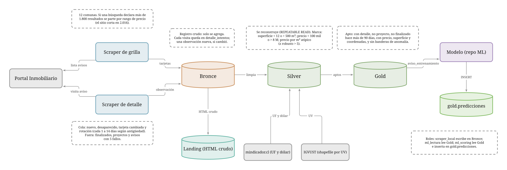
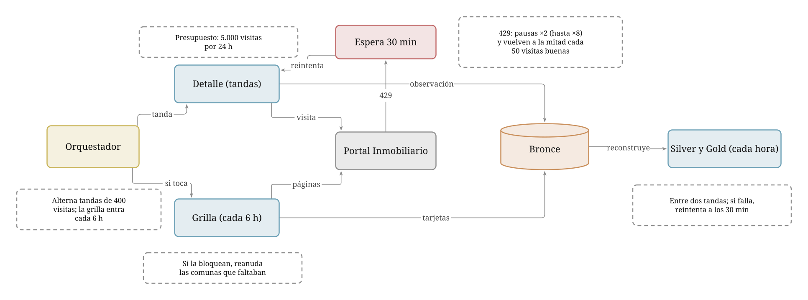

# santiago-rentals-elt

Repo del **ELT** (scrapers, Bronce, Silver y Gold). El modelo vive en el repo hermano
`santiago-rentals-ml`; el único punto de contacto es `gold.aviso_entrenamiento` en Supabase.

Captura de avisos de **arriendo de departamentos** de Portal Inmobiliario en la **Región Metropolitana**,
con arquitectura medallón (Bronce → Silver → Gold). El objetivo final es dejar en Gold datos limpios para
**entrenar un modelo** que estime el costo total mensual de un arriendo. Existen las tres capas (Bronce, Silver y Gold); el estado de cada pieza está en la tabla de abajo.

Los scrapers se ejecutan **de forma local** (no en GitHub Actions) y escriben a un proyecto Supabase
propio. La razón: el sitio bloquea las IPs de datacenter, y en el proyecto de Concepción eso pasó
inadvertido durante 17 días (ver `docs/01_antecedentes_concepcion_y_databricks.md`).

## Estado actual

| Pieza | Estado |
|---|---|
| Landing (HTML crudo en disco) | Funcionando |
| Bronce: grilla | Funcionando. Primera carga completa de las 23 comunas; desde el 2026-10-19 se scrapean 12 |
| Bronce: detalle | Funcionando. Primera carga a medias: 13.035 de ~14.900 avisos con observación |
| Silver: `silver.avisos` | Funcionando (14.947 filas; se reconstruye completa desde Bronce) |
| Silver: `silver.aviso_observaciones` | Funcionando (una fila por cambio observado en el detalle; hoy 1 por aviso) |
| Nivel socioeconómico (IGVUST) | Funcionando: 1.369 Unidades Vecinales de la RM en Bronce; los 1.194 avisos con coordenadas cayeron dentro de una |
| Gold: SCD2 de estado y de precio | Funcionando; sin historia real todavía (1 intervalo por aviso). Probado con un historial simulado |
| Gold: `gold.aviso_entrenamiento` | Funcionando: 14.947 avisos, 12.597 aptos (1.912 aún sin detalle; el resto, ~440, excluidos por calidad). Incluye el título y la descripción del aviso, que usa el modelo |
| Gold: `gold.predicciones` | La escribe el scoring por lotes del modelo (rol `ml_scoring`, `INSERT` y `SELECT`): predicción, etiqueta de mercado (oportunidad / precio de mercado / caro), confianza y banda de mercado. `gold.predicciones_vigentes` es la última de cada aviso |
| Modelo | Funcionando en el repo `santiago-rentals-ml` |
| Orquestador y tarea programada de Windows | Pendientes |

Cifras al 18-oct-2026 (cambian con cada corrida):

| Dato | Valor |
|---|---|
| Avisos distintos vistos en la grilla | ~14.900 |
| Comunas con cobertura completa | 23 de 23 (Santiago: 4.299 de 4.299) |
| Visitas de detalle registradas | 4.584 (4.541 `ok`, 31 `proyecto`, 11 `no_encontrado`, 1 `bloqueado`) |
| Observaciones de detalle guardadas | 4.538 |
| Tamaño del schema `bronze` en Supabase | ~34 MB |
| HTML crudo en disco | ~660 MB |

## Arquitectura

```
Portal Inmobiliario
        │  requests + BeautifulSoup (IP local, delays de 3 a 7 s)
        ▼
┌───────────────────────────┐        ┌────────────────────────────────────────┐
│ bronze/scraper_grilla.py  │        │ bronze/scraper_detalle.py              │
│  qué avisos existen       │        │  qué dice cada aviso (estado y precio) │
│  12 comunas, por rango de │        │  cola de prioridades derivada con SQL  │
│  precio si superan 1.800  │        │                                        │
└───────────┬───────────────┘        └───────────────┬────────────────────────┘
            │                                        │
            ├──────────────► landing/ (HTML crudo .gz, local) ◄───────────┤
            ▼                                        ▼
┌─────────────────────────────────────────────────────────────────────────────┐
│ Supabase (Postgres) · schema bronze · solo inserciones                      │
│  grilla_avisos  grilla_vistos  grilla_paginas  grilla_cobertura             │
│  detalle_avisos detalle_intentos  runs                                      │
│  igvust_uv  (referencia estática: nivel socioeconómico por Unidad Vecinal)  │
└─────────────────────────────────────────────────────────────────────────────┘
            │
            ▼   silver/construir_silver.py  (solo lee Bronce; nunca toca el sitio)
        Silver: tipado, normalización de monedas, banderas de calidad (superficie, precio, costo por m2
                atípico en su comuna), Unidad Vecinal de cada aviso
                silver.avisos (estado actual) · silver.aviso_observaciones (historia tipada)
                silver.indicadores_diarios (UF y dólar) · silver.aviso_uv
            ▼   gold/construir_gold.py  (solo lee Silver)
        Gold: gold.dim_estado_aviso_scd2 · gold.dim_precio_aviso_scd2 · gold.aviso_entrenamiento
              gold.predicciones (no se reconstruye: solo recibe filas del modelo)
            ▼   santiago-rentals-ml
        Modelo de ML
```

### Capas

**Landing (`landing/`).** HTML crudo comprimido, local y fuera de git. Permite volver a parsear sin volver
a pedir las páginas. La grilla guarda cada página (`landing/<fecha>/<tipo>/<comuna>/pNNN.html.gz`, con una
subcarpeta `seg_<min>-<max>` cuando hay rango de precio). El detalle guarda el HTML solo cuando entra una
observación nueva (`landing/detalle/<fecha>/<id>.html.gz`).

**Bronce (Supabase, schema `bronze`).** Datos tal como vienen del sitio: sin limpiar, sin convertir
monedas, sin interpretar estados. Es **solo de inserción**: ninguna fila se actualiza. Los strings crudos
se guardan como `jsonb`.

| Tabla | Rol |
|---|---|
| `runs` | Una fila por ejecución de un scraper (inicio, fin, estado, páginas, filas) |
| `grilla_paginas` | Una fila por página pedida: URL, HTTP, tarjetas, total declarado, ruta del HTML, rango de precio. Es el log de auditoría |
| `grilla_avisos` | Tarjetas de la grilla. Se inserta una fila **solo si cambió** (hash del payload) |
| `grilla_vistos` | Primera y última vez que un aviso apareció en la grilla (permite detectar desaparecidos) |
| `grilla_cobertura` | Por comuna y corrida: total declarado, avisos únicos capturados y si quedó `completa` o `parcial` |
| `detalle_intentos` | Una fila por visita a un aviso, con su resultado. De acá se deriva la cola de pendientes |
| `detalle_avisos` | Observaciones del detalle: evidencia cruda de estado y precio, más el resto de los campos. Solo si lo observado cambió |

El DDL está versionado en `bronze/sql/` (`001_schema`, `002_detalle`, `003_cobertura`) y se aplica con
`scripts/aplicar_ddl.py`. Cada cambio de schema va en un archivo nuevo.

## Flujo de la grilla (`bronze/scraper_grilla.py`)

1. Para cada comuna de `config.COMUNAS_RM` pide la página 1 y lee el total declarado ("N resultados").
2. Si el total supera **1.800**, la búsqueda se parte en rangos de precio (`_PriceRange_<min>CLP-<max>CLP`).
   El sitio corta cada búsqueda en 2.016 resultados (página 42) y responde 404 desde la 43. Parte de una
   escalera de rangos y divide a la mitad cualquiera que siga siendo grande. Los bordes se solapan y los
   duplicados se absorben por ID.
3. Recorre las páginas de cada búsqueda, guarda el HTML y las tarjetas. Solo se usa el selector
   `li.ui-search-layout__item`; los de `div` también capturan publicidad.
4. Al cerrar cada comuna compara los avisos únicos capturados con el total declarado y registra la cobertura
   (`completa` si faltan menos de max(10, 1 %)). Una corrida con alguna comuna `parcial` queda `parcial`.
5. **Detección de bloqueo.** Si 3 búsquedas seguidas traen la página 1 vacía sin que el sitio diga "0
   resultados", o hay HTTP 403/429, aborta y marca la corrida `bloqueado`. Una respuesta vacía nunca es un
   éxito.

El hash de cada tarjeta excluye el fragmento de la URL (`url_fragmento`), que trae un `tracking_id` aleatorio
por request.

## Flujo del detalle (`bronze/scraper_detalle.py`)

Un solo script para la primera visita y las revisitas. La cola se calcula con SQL, sin contadores mutables,
y se ordena por prioridad:

| Prioridad | Motivo | Condición |
|---|---|---|
| 1 | `nuevo` | Nunca se visitó con éxito (más recientes primero) |
| 2 | `desaparecido` | No apareció en la última corrida **completa de su comuna** y su última visita exitosa es de hace más de 2 días |
| 3 | `tarjeta_cambio` | Su tarjeta de la grilla cambió desde la última visita |
| 4 | `rotacion` | Sin revisar hace más de 7 días |

Quedan fuera de la cola los avisos cuyo último estado contiene "finaliz" (terminal; un pausado sí se
revisa), los que ya se clasificaron como `proyecto`, y los que acumulan 5 fallos seguidos o fallaron hace
menos de 12 horas.

**Qué guarda cada visita exitosa:** el texto crudo del banner de estado (`NULL` si el aviso está activo), el
precio vigente, su moneda (`CLP`, `CLF` = UF) y el precio original si hay rebaja, el canonical y el og:url,
y el resto de los campos (superficie, dormitorios, baños, coordenadas, barrio, descripción, gastos comunes,
amenities y los subtítulos crudos de puntos de interés). Bronce **no interpreta**: si un aviso está
pausado o finalizado se decide en Silver.

**Resultados posibles de una visita:** `ok`, `error`, `no_encontrado`, `captcha`, `bloqueado` y `proyecto`.

**Defensas contra falsos "eliminado":**

- El muro de verificación de cuenta se detecta por la URL final y aborta la corrida sin tocar ningún aviso.
- Un aviso solo se considera inalcanzable tras varios fallos entre corridas, nunca por uno solo.
- 8 fallos seguidos en una corrida la abortan como `bloqueado`.
- Si la base corta la conexión (por ejemplo, al suspender el equipo), el scraper **reconecta y repite la
  operación** (`common/db.py::ConexionResiliente`, con esperas de 5 a 180 s) en vez de abortar. Si no logra
  reconectar, cierra la corrida como `error`. La grilla hace lo mismo con sus escrituras.
- **Ante un 429 no aborta:** espera 30 minutos, duplica las pausas (hasta x8) y reintenta el mismo aviso. Anota
  cuántas visitas aguantó entre bloqueos (en `bronze.runs.detalle` y en el log) para estimar el umbral real de la IP.
  Cuando el sitio deja de bloquear, cada 50 visitas buenas seguidas las pausas bajan a la mitad hasta volver a las
  originales. Solo aborta como `bloqueado` si 3 bloqueos seguidos no dejan avanzar ninguna visita.
  El factor de pausa con que termina cada tanda se guarda en `logs/detalle_ritmo.json` y la tanda siguiente lo retoma (si
  fue hace menos de 2 horas), así la recuperación tras un 429 continúa entre tandas en vez de reiniciarse al ritmo base.
- **Rotación escalonada por antigüedad:** un aviso activo se vuelve a visitar cada 1, 2, 4, 7 o 14 días según tenga
  hasta 14, 30, 60, 120 o más días de publicado (`DIAS_ROTACION_TRAMOS`). La edad sale del texto de Bronce ("hace 13 días",
  "esta semana"…) más los días transcurridos; sin fecha cuenta como reciente. En la rotación va primero el más atrasado
  respecto de su intervalo. Son unas 5.500 visitas por día si todo estuviera al día: se puso alto a propósito para
  buscar el límite del sitio, y cada bloqueo registra cuántas visitas hubo en la última hora y en 24 h.
- **Presupuesto de visitas:** `--presupuesto-dia` (1.500 por defecto) limita las visitas de una ventana móvil de 24 h,
  contando todas las corridas. La rotación recorre primero lo visitado hace más tiempo, así que con presupuesto
  limitado el ciclo completo se reparte sin dejar avisos sin revisar.
- **Solo las comunas de `config.COMUNAS_RM`:** la cola excluye avisos de otras comunas (`--comunas` cambia la lista).
- **Log de avance:** además de la pantalla, cada corrida agrega sus líneas a `logs/detalle.log` (fuera de git).
  Cada 50 visitas escribe una línea `Avance: 150/1322 (11 %) | 8,3 visitas/min | observaciones nuevas 148 |
  sin leer 4 | resta ~2 h 20 min`. También quedan la cola inicial, cada aviso que no se pudo leer, las
  reconexiones y el resumen final. El avance exacto está además en `bronze.detalle_intentos`.
- **Log de la grilla:** `logs/grilla.log` (fuera de git), un resumen y no una línea por página: `INICIO`, una línea
  por comuna (`[ 3/23] providencia  480 de 530 declarados (90,6 %) | INCOMPLETA | 12 págs | 4 min 43 s`),
  `SEGMENTA` cuando parte por precio, `ALERTA` ante una página 1 vacía, un error de red o un rango que no se
  puede partir, `ABORTADO` con el motivo y `FIN` con las comunas incompletas. Con `--detalle` agrega una línea
  por página para depurar. Los dos scrapers escriben a pantalla y a su archivo fijo; no hay un log por turno.
- Los **proyectos inmobiliarios** (que la grilla también lista como "Desde $X … N unidades disponibles")
  redirigen a una página de proyecto con otro ID. Se registran como `proyecto` y se excluyen; no sirven para
  el modelo.

## Decisiones de diseño

| Decisión | Motivo |
|---|---|
| Ejecución local, no GitHub Actions | El sitio bloquea IPs de datacenter. Probado el 2026-10-19 desde un runner (rama `prueba-actions`): los 3 pedidos redirigieron a `/gz/account-verification` |
| Solo departamentos en arriendo | Alcance del modelo |
| Bronce de solo inserción, con hash | Historial de cambios sin repetir lo que no cambió |
| Evidencia cruda, interpretación en Silver | Los incidentes de Concepción se agravaron porque el veredicto se guardaba junto al dato |
| La cola de detalle se deriva con SQL | Sin contadores mutables |
| "Desaparecido" se evalúa por comuna | Una corrida parcial no debe hacer parecer desaparecidos a los avisos de otras comunas |
| El precio vigente y el estado salen del detalle | La grilla solo aporta una señal barata de que algo cambió |
| Segmentar por precio, no por dormitorios | "1 dormitorio" por sí solo declara 2.454, más que el tope de 2.016 |
| HTML crudo a disco | Reproducibilidad; Supabase gratis tiene 500 MB |
| Sin conversión de monedas ni de fechas relativas en Bronce | La fecha absoluta se calcula en Silver restando el texto a `scraped_at` |

## Estructura

```
santiago-rentals-elt/
├── config.py                  # comunas, URL base, headers, delays, ruta del landing
├── requirements.txt
├── .env                       # BD_STRING (dueño) y BD_STRING_SCRAPER (Session pooler de Supabase); no se versiona
├── common/db.py               # conexión a Supabase
├── bronze/
│   ├── scraper_grilla.py
│   ├── scraper_detalle.py
│   ├── orquestador.py         # alterna detalle y grilla; espera y reanuda ante un 429
│   └── sql/                   # 001_schema, 002_detalle, 003_cobertura
├── scripts/
│   ├── aplicar_ddl.py         # aplica los .sql en orden (idempotente)
│   ├── spike_slugs.py         # verificó los slugs de las 23 comunas
│   └── spike_detalle.py       # verificó dónde viven estado y precio en el detalle
├── docs/
│   ├── 01_antecedentes_concepcion_y_databricks.md
│   └── 02_bitacora_problemas.md
├── landing/                   # HTML crudo (local, fuera de git)
├── logs/                      # logs de corridas largas (fuera de git)
├── silver/
│   ├── construir_silver.py    # DDL, UF y dólar, y reconstrucción de silver.avisos y aviso_observaciones
│   ├── asignar_uv.py          # cruce punto-en-polígono: Unidad Vecinal de cada aviso
│   └── sql/                   # 001_schema (funciones y tablas), 010_construir_avisos
├── gold/
│   ├── construir_gold.py      # DDL y reconstrucción de los SCD2 y del dataset, con chequeos de integridad
│   └── sql/                   # 001_schema, 010_scd2, 020_aviso_entrenamiento
├── datos_externos/igvust/     # shapefile del índice socioeconómico (128 MB, fuera de git)
```

Se scrapean 12 comunas centrales o de interés: Santiago, Ñuñoa, Providencia, Estación Central, San Miguel,
Independencia, Macul, La Florida, Recoleta, Huechuraba, Quinta Normal y Conchalí. Las otras 11 (Las Condes, Vitacura,
Lo Barnechea, La Reina, Peñalolén, Quilicura, Maipú, Puente Alto, San Bernardo, Cerrillos y Pedro Aguirre Cerda)
quedaron fuera el 2026-10-19; sus avisos ya cargados siguen en Bronce. Se cambian editando `config.COMUNAS_RM`.

## Cómo ejecutar

**Todo el ciclo, sin intervención:** `python bronze/orquestador.py` alterna detalle y grilla (detalle, grilla, detalle…),
con un presupuesto de 6.000 visitas de detalle por 24 h (`--presupuesto-dia`).
El detalle trabaja en tandas de 400 visitas (`--tanda`) y, entre tandas, el orquestador revisa si ya toca la grilla, que corre como máximo cada 6 horas (`--grilla-cada-horas`) aunque la cola del detalle sea larga. Si el detalle termina bloqueado, espera 30, 60 y luego
120 minutos y lo relanza; si la grilla es bloqueada, espera igual y reanuda solo con las comunas que faltaban. Si se agota
el presupuesto de 24 h, espera a que se libere. Las pausas entre peticiones son de 6 a 12 s (`--pausa-min/--pausa-max`).
Su registro es `logs/orquestador.log`; para detenerlo con calma se crea el archivo `logs/orquestador.stop`.

Cada scraper por separado:

Requisitos: Python con `requests`, `beautifulsoup4`, `lxml`, `psycopg2-binary` y `python-dotenv` (ver
`requirements.txt`), y un `.env` con `BD_STRING` (rol dueño) y `BD_STRING_SCRAPER` (rol `scraper_local`), connection strings del **Session pooler** de Supabase,
que funciona por IPv4).

```bash
python scripts/aplicar_ddl.py                              # crea o actualiza el schema bronze

python bronze/scraper_grilla.py                            # todas las comunas
python bronze/scraper_grilla.py --comunas quilicura-metropolitana --max-paginas 2   # prueba chica
python bronze/scraper_grilla.py --sin-bd                   # solo landing, sin escribir en Supabase

python bronze/scraper_detalle.py --limite 300              # visita hasta 300 avisos de la cola
python bronze/scraper_detalle.py --limite 20 --motivos nuevo
python bronze/scraper_detalle.py --comunas nunoa-metropolitana   # solo esas comunas (por defecto, config.COMUNAS_RM)
python bronze/scraper_detalle.py --limite 20000 --presupuesto-dia 1200   # el presupuesto manda sobre el límite

python bronze/cargar_igvust.py                             # una vez (o al actualizar el shapefile)
python silver/construir_silver.py                          # reconstruye Silver desde Bronce
python gold/construir_gold.py                              # reconstruye Gold desde Silver
```

Todo es **reanudable**: si una corrida se corta, volver a lanzar el mismo comando retoma desde la cola. El
PC debe quedar encendido y sin suspenderse durante las corridas largas. La primera carga completa del
detalle son unos 15.000 avisos: con el ritmo medido (~8,7 visitas por minuto) son unas 29 horas. Al
terminar ocuparán unos 2 GB de HTML en `landing/` y ~70 MB en Supabase.

## Lo que falta

1. Terminar la primera carga del detalle por tandas.
2. Orquestador local (grilla y luego detalle) y tarea programada de Windows con reintento al reanudar.
3. **Roles de Postgres de mínimo privilegio (hechos el 18-oct-2026):** `scraper_local` (`SELECT`, `INSERT` y
   `UPDATE` en `bronze`; sin crear, borrar ni vaciar tablas), `ml_lectura` (`SELECT` sobre
   `gold.aviso_entrenamiento`) y `ml_scoring` (ese `SELECT` más `INSERT` en `gold.predicciones`). Se crearon en
   Supabase y el SQL no se conserva en el repo. Los scrapers usan `BD_STRING_SCRAPER`; Silver, Gold y las
   migraciones siguen con `BD_STRING` (rol dueño).
4. **Silver y Gold** ya existen (ver el estado de arriba). El orquestador (`bronze/orquestador.py`) solo encadena
   detalle y grilla; falta incluir Silver y Gold y revisar los umbrales de las banderas de calidad y de aptitud, que son provisionales.
5. **Validar los SCD2 con historia real**, cuando las revisitas acumulen varios días de cambios.
6. **Modelo:** vive en el repo `santiago-rentals-ml`. Target decidido: `costo_total_clp`. Las variables que
   dependen del split (`nivel_barrio`, `precio_m2_sector`, imputación de superficie) se ajustan solo con
   train. Detalle en `docs/01_decisiones.md` de ese repo.
7. **Repos separados (hecho el 2026-10-17):** este repo (ELT) corre local; el de modelo corre en GitHub Actions.
8. **Scoring por lotes** del modelo sobre `gold.predicciones` (ya creada: aviso, versión del modelo,
   costo estimado, fecha), con el rol `ml_scoring` que solo puede insertar en ella.
9. **Sin API pública** de datos ni de predicción: Bronce, Silver y Gold son privados.

Dónde ocurre cada cosa: **solo Bronce habla con el sitio**. La revisión de estado y precio de los avisos es
`bronze/scraper_detalle.py` (primera visita y revisitas, el mismo script). Silver y Gold nunca tocan
el sitio: leen lo que Bronce dejó. La única llamada externa fuera de Bronce es la de Silver a `mindicador.cl`
(UF y dólar).

## Diagramas

Hechos con [Fluyo](https://fluyo.space). Cada diagrama es un `.svg` (vista estática, la que se ve aquí) y un `.fluyo.json` en
`docs/diagramas/`; ese archivo se abre con el botón **Abrir** de fluyo.space para reproducir sus **Historias** (el orden en el
tiempo de un proceso, animado) y exportar un GIF. Los scripts que los generan están en `docs/diagramas/herramientas/` (ver su
`LEEME.md`).

### Arquitectura del ELT



El recorrido de un aviso desde el portal hasta su predicción, de izquierda a derecha:

- **Captura.** Dos scrapers visitan el portal. La *grilla* descubre qué avisos existen en las 12 comunas (si una búsqueda
  declara más de 1.800 resultados se parte por rango de precio, porque el sitio corta en 2.016). El *detalle* visita cada aviso
  para leer su estado y su precio, siguiendo una cola de prioridades: nuevo, desaparecido, tarjeta cambiada y rotación por
  antigüedad; quedan fuera los finalizados, los proyectos y los avisos con 5 fallos.
- **Bronce.** Registro crudo, al que solo se agrega: cada visita queda en `detalle_intentos` y una observación nueva solo si el
  aviso cambió. El HTML original queda aparte en *landing* (local, fuera de git).
- **Silver.** Limpia y une las fuentes: UF y dólar de mindicador.cl a la fecha del precio, y la unidad vecinal (IGVUST) de cada
  aviso. Marca banderas de anomalía: superficie < 12 o > 500 m², precio < 100 mil o > 8 M y precio por m² atípico.
- **Gold.** `aviso_entrenamiento` deja como aptos los avisos con detalle, que no son proyecto ni finalizados hace más de
  90 días, con precio, superficie y coordenadas, y sin banderas. Es el único punto de contacto con el repo del modelo, que
  devuelve sus predicciones a `gold.predicciones`.
- **Permisos.** `scraper_local` escribe en Bronce, `ml_lectura` lee Gold y `ml_scoring` lee Gold e inserta predicciones.

Historias: *Un aviso nuevo, de la publicación a la predicción* (diez pasos, de la grilla a la tabla de predicciones) y
*Un 429: espera y retoma con menos ritmo*.

### Orquestador del scraping



Cómo se mantienen activos los dos scrapers sin intervención y qué hacen cuando el sitio los frena:

- **Orquestador.** Alterna *tandas* de 400 visitas del detalle y, cada 6 horas, la grilla, que entra a su hora aunque la cola
  del detalle sea larga. Si no hay nada que visitar, espera hasta 30 minutos y vuelve a mirar.
- **Detalle.** Recorre su cola con un presupuesto de visitas por ventana móvil de 24 horas y pausas aleatorias entre visitas
  (configurables; hoy de 3 a 6 s). La rotación revisa cada aviso activo cada 1, 2, 4, 7 o 14 días según su antigüedad.
- **Un 429.** El scraper no aborta: espera 30 minutos, duplica las pausas (hasta ×8) y las baja a la mitad cada 50 visitas
  buenas hasta volver a las originales. El ritmo con que termina una tanda se guarda y la siguiente lo retoma. Si 3 bloqueos
  seguidos no dejan avanzar, aborta y el orquestador espera 30, 60 o 120 minutos antes de relanzarlo.
- **Grilla.** Si el sitio la bloquea, reanuda solo las comunas que le faltaban. Una grilla incompleta no marca avisos como
  desaparecidos en las comunas que no cubrió.

Historias: *Una tanda de detalle y la grilla a su hora*, *Un 429 y la recuperación* y *La grilla bloqueada reanuda lo que
faltaba*.

## Documentación

- `docs/diagramas/`: diagramas de proceso hechos con Fluyo (ver la sección *Diagramas*).
- `docs/01_antecedentes_concepcion_y_databricks.md`: arquitectura, decisiones y problemas de los dos
  proyectos anteriores, con la referencia técnica de limpieza, features y modelo para Silver y Gold.
- `docs/02_bitacora_problemas.md`: problemas de este proyecto y cómo se resolvieron. Se actualiza con
  cada problema nuevo.
- Las decisiones de la etapa de modelo (MLflow, CI/CD, scoring por lotes, sin API) están en
  `docs/01_decisiones.md` del repo `santiago-rentals-ml`.

## Antes de mover esta carpeta a otro repo

- `landing/` y `logs/` quedan fuera de git por el `.gitignore` de esta carpeta, pero ocupan espacio en disco
  y no deben ir a una carpeta sincronizada.
- El `.env` con `BD_STRING` no se versiona; en el repo nuevo hay que volver a crearlo a mano (lleva `BD_STRING` y `BD_STRING_SCRAPER`, connection strings del Session pooler).
